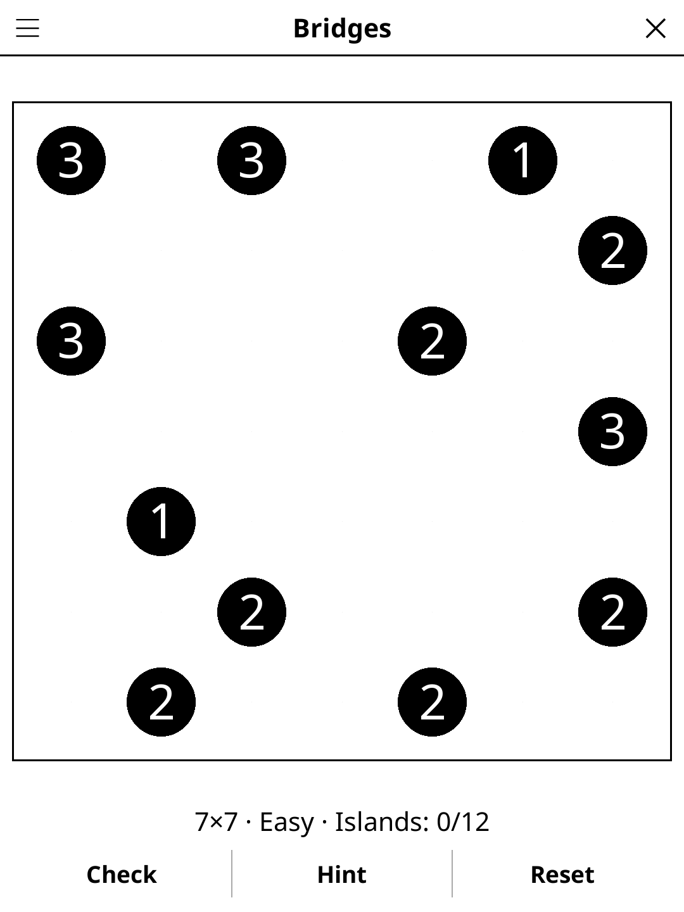

# bridges.koplugin

A Bridges (Hashi) puzzle plugin for [KOReader](https://github.com/koreader/koreader).

## Screenshot

## Rules

Connect all islands with bridges. Each island's number indicates how many bridge segments must attach to it. Up to two bridges may connect any pair of islands. Bridges run horizontally or vertically and cannot cross. All islands must be joined into one network.

## Features

- **Multiple grid sizes** — 7×7, 9×9, 11×11
- **Hint** — two taps, working on a bridge between two islands rather than a cell; a pair with too many bridges is fixed first
- **Three difficulty levels** — Easy, Medium, Hard: more islands and harder
  deductions at each level; every puzzle has exactly one solution and never
  needs trial and error
- **Double bridges** — tap twice for a double bridge
- **Check** — tells how many islands have their number of bridges
- **Auto-save** — puzzle state saved and restored on next launch

## Installation

1. Download `bridges.koplugin.zip` from the [latest release](../../releases/latest).
2. Extract into the `plugins/` folder of your KOReader data directory.
3. Restart KOReader.
4. Open the menu → **Tools** → **Games** → **Bridges**.

## Controls

| Action | How |
|--------|-----|
| Build / double / remove a bridge | Tap an island, then another island in the same row or column (0 → 1 → 2 → 0) |
| Check progress | Tap **Check** |
| Get a hint | Tap **Hint** |
| Remove every bridge | Tap **Reset** |
| New game, Daily Challenge, size, difficulty, rules | Menu (top left) |

## License

GPL-3.0 — see [LICENSE](LICENSE).
